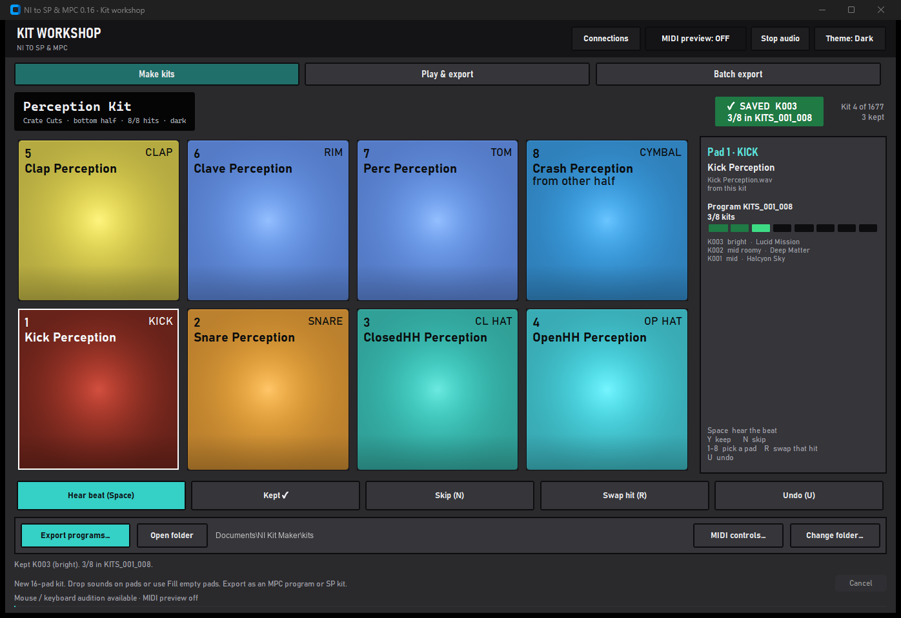

# NI-kit-sieve

**Sift through thousands of Native Instruments Maschine drum kits and keep only the ones you want.**
NI-kit-sieve reads your installed NI expansions, builds ready-to-play 8-pad drum kits from them, lets you hear each
one in seconds, and packs the ones you keep into **MPC1000 programs**.



## What it does

You have many GB of expansions. Auditioning them kit by kit takes forever. NI-kit-sieve does the boring part:

1. **Finds the drums** in every kit and arranges them in one fixed layout (below).
2. **Plays you a short beat** from each kit so you can judge it at once.
3. **You press Keep or Skip.** Kept kits are saved. Skipped kits never come back.
4. **Exports MPC1000 programs.** Every 8 kept kits become one program: 4 banks, two kits per bank.

Your original samples are never changed. No NI content is included in this repo; you need your own installed expansions.

## The kit layout

Every kit uses the same pads, so your MPC always behaves the same way. Pad 1 is bottom-left.

```
5 CLAP    6 RIM     7 TOM      8 CYMBAL
1 KICK    2 SNARE   3 CL HAT   4 OP HAT
```

Closed and open hat cut each other off. If a kit has no clap, tom or cymbal, the app fills the gap with a matching
sound from the same expansion (the pad says "from other half").

## Quick start

You need Windows and Python 3.12.

```powershell
git clone https://github.com/diamond-one/NI-kit-sieve.git
cd NI-kit-sieve
python -m venv .venv
.\.venv\Scripts\Activate.ps1
python -m pip install -r requirements.txt
python run.py
```

1. Open the **Make kits** tab. The first read of a big library takes under a minute and is cached after that.
2. If no kits appear, go to **Play & export** and set **NI Expansions Location**. The usual place is `C:\Users\Public\Documents`.
3. Press **Space** to hear a kit. Press **Y** to keep it or **N** to skip it.

## Keys

| Key | Does |
| --- | --- |
| **Space** | Hear the beat. Press again to stop. |
| **Y** | Keep this kit (a green badge confirms it and shows how full the program is). |
| **N** | Skip this kit. |
| **1–8** | Select a pad. |
| **R** | Swap the selected hit for a similar sound from the same expansion. |
| **U** | Undo the last keep or skip. |

## Use your MIDI pads

Turn on **MIDI preview**, then hit a pad on your controller to select the same pad on screen. That lets you
swap sounds without touching the keyboard. Press **MIDI controls…** to teach a pad or button to do Hear, Keep,
Skip, Swap, Undo or next/previous pad. Taught pads work only on the Make kits tab.

## Where your kits go

Kept kits are saved in `Documents\NI Kit Maker\kits` (change it with **Change folder…**). Each kit is a folder of
eight 44.1 kHz / 16-bit WAV files plus a manifest.

- Kits are named `K001`, `K002`… and are never renumbered.
- Programs are named `KITS_001_008`, `KITS_009_016`… (8 kits each).
- `CATALOGUE.csv` lists every kit's character (for example "dark tight"), source expansion and position on the MPC.
- Press **Export programs…** and copy the folders to your MPC card.

## Which kits do I hear, and will I hear a kit twice?

- The queue is built from the kits found in your library, complete kits first, taking turns between expansions.
- Within one calendar day the order is the same each time you start the app. The next day it is reshuffled.
- Kits you keep or skip are remembered in `seen.json` in your kit folder, so they do not come back after a restart.
  Kits with the same kick, snare and hat files are hidden too.
- Copies of the same sound in two different expansions are not detected. If you delete `seen.json`, old kits can return.

## More

- [Advanced guide](docs/ADVANCED.md): the Play & export workbench, SP-404MKII transfer, MIDI setup for MPC and SP, troubleshooting.
- [Validation notes](VALIDATION.md): what was tested, and what was not (exporting to a physical MPC card has not been tested here).
- Run the tests with `python -m unittest discover -s tests -v`.

## Credits

MPC export builds on Stephen Norum's [pympc1000](https://github.com/stephenn/pympc1000) (zlib licence) and CrateBuilder.
SP USB transfer uses [SparkyMK2](https://github.com/TuscanPL/SparkyMK2). See [third-party notices](licenses/THIRD-PARTY.txt).
Native Instruments, Roland and Akai do not endorse this app.
