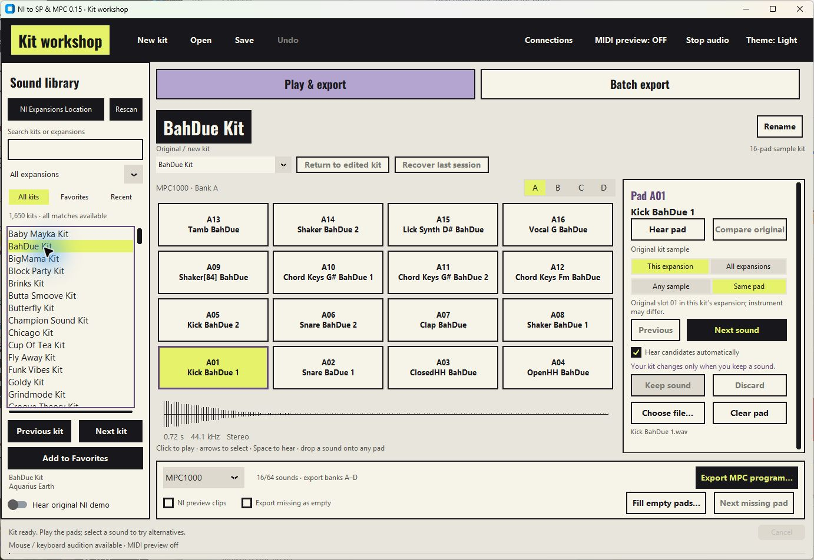

# NI to SP & MPC

**[Download the Windows app](https://github.com/diamond-one/NI-Expansion-to-SP404MK2-and-MPC1000-2500/releases/latest)** · Extract the ZIP and open `NI-to-SP-0.15.exe`.

Turn installed Maschine expansion samples into **SP-404MKII kits** or **MPC1000 programs**. Hear sounds, replace pads and build your own kits before exporting.

Maschine and Python do not need to be running. Your original samples stay untouched. Synths, EQ and effects are not rendered.



[View dark mode](docs/screenshots/dark-mode.png)

## Make your first kit

Allow about **five minutes for setup**, plus download and library scanning time.

1. **Open the app.** Your installed expansions are scanned automatically.
2. **Find your kits.** If the list is empty, choose **NI Expansions Location** and select the folder containing your NI libraries. The usual location is `C:\Users\Public\Documents`.
3. **Choose a kit** from the list, or choose **New kit** to start with your own samples.
4. **Click a pad to hear it.** Replace any pads marked **Needs sound** using the steps below.
5. **Choose your export target:** SP-404MKII or MPC1000. Follow the matching export steps below.

**You can audition with the mouse straight away. MIDI setup is optional.**

Use **Theme: Light / Dark** in the top bar to switch appearance. Your choice is
remembered. Switching keeps your kit, banks, Undo history and MIDI preview running.

## Change a sound

1. **Select a pad.**
2. Choose **This expansion** or **All expansions**, then **Any sample** or **Same pad**. Press **Next sound** to try a random replacement.
3. Use **Compare original** to compare it. Press **Keep sound** to commit, or **Discard** to leave the pad as it was.

**Same pad** finds sounds assigned to that pad position in other NI kits. It does not guarantee the same instrument type.

| Bring your own sounds | What happens |
| --- | --- |
| **Choose file…** | Auditions a replacement before you keep it. |
| Drop a sample onto a pad | Assigns it immediately. **Undo** restores the previous sound. |
| **Fill empty pads…** | Adds several files without replacing usable sounds. |
| **Clear pad** | Makes a pad deliberately empty. **Undo** restores it. |

Temporary replacements must be kept or discarded before saving or exporting. Switching to another pad discards the temporary replacement.

## Build MPC banks A–D

Use the app's **A, B, C and D** buttons to choose the bank you are editing. Each bank holds 16 sounds; one MPC program can contain **64 sounds**.

Switching banks keeps your work. Loading an NI kit replaces the selected software bank while keeping the other three banks.

**MPC export includes all four banks. SP export uses only the bank currently shown.**

## Export to your sampler

### SP-404MKII

1. Select **SP-404MKII** as the export target and connect the SP by USB.
2. Press **Send to SP…**. Review the project, destination bank and pad layout.
3. Press the named **Send** button to transfer the kit.

The destination defaults to the bank selected on your SP when its status can be read. Choose a bank yourself if the app cannot read it.

**Replace existing pads** is off by default. Turn it on to replace occupied pads. The app saves and checks recovery backups before replacing samples; restoring a backup is manual. Protected banks and changed destinations block the transfer.

To prepare files without sending them, use **Export SP WAVs…** instead.

### MPC1000

1. Select **MPC1000** and press **Export MPC program…**.
2. Choose where to save the program folder.
3. Copy the **whole folder** to your MPC storage. On the MPC's LOAD page, load the `.PGM` with its samples.

The folder contains one MPC1000 program, its WAVs, a pad map and loading instructions. Banks A–D retain their pad positions; unused pads stay empty.

### Export many NI kits

Open **Batch export** and choose **Matching kits** or **All expansions**.

Batch export creates **SP WAV kit folders** and a report of exported or skipped kits. It uses the original NI kits and the selected preview/missing-sound options. Export your edited MPC program from **Play & export**.

## Preview from your hardware pads

MIDI triggers the app's sounds **through your computer's audio output**. You can hear a kit before importing it into the sampler.

Choose your listening device under **Connections → Audio output**.

### MPC1000 / JJOS3

1. Connect **MPC MIDI OUT A → MIDI interface IN**. The MPC's USB port is for storage transfer.
2. On the MPC MAIN screen, set the active MIDI track's output to **1A**. **OFF** prevents pad notes from reaching this connection.
3. In **Connections**, choose your interface input, **MPC1000 / JJOS3 · MIDI track**, and channel **Any**. Press **Save connections**.
4. Turn **MIDI preview ON** and play the pads.

**All four hardware banks play the software bank currently shown.** Use the app's A–D buttons to choose which bank you edit and hear.

This setup has been checked with a physical MPC1000: sound and pad positions were confirmed, including pad 1 in banks A, B and D.

<details>
<summary>Using a drum program or custom MIDI mapping?</summary>

Choose **MPC1000 / JJOS3 · program pads** when your outgoing notes follow a drum program's pad map. **Load MPC program map…** reads a `.PGM` file's note assignments without copying samples or changing the MPC. **Use standard map** restores the default program mapping.

The **MIDI track** preset uses notes 36–99 across banks A–D. Program maps use different assignments, so select the profile that matches your track.

For another layout, enable preview, right-click a software pad and choose **Learn MIDI note**. Hit the corresponding hardware pad once to learn it; subsequent hits play it. Changing profiles clears learned overrides.

The app receives MIDI only. JJ's `mpc-ctl` bank/transport commands control the MPC in the opposite direction.

</details>

### SP-404MKII

1. Connect the SP by USB and enable **PAD Note Out** on the hardware.
2. In **Connections**, select **SP-404 Mode A** or **Mode B** to match the SP. Choose the SP audio output to listen through it.
3. Turn **MIDI preview ON** and play the pads.

Use an empty hardware bank to avoid hearing the SP's existing samples alongside the app.

## Understand the preview and missing-sound options

| Control | Use it for |
| --- | --- |
| **Hear original NI demo** | Automatically hear the supplied original kit demo when browsing. It does not include your edits. |
| **NI preview clips** | Fill some unresolved pads with matching NI audition clips. These may be phrases or approximations. Off by default. |
| **Export missing as empty** | Export an incomplete kit: unassigned MPC pads or silence WAVs for SP positions. Off by default. |

**For a complete kit, replace pads marked Needs sound before exporting.** Deliberately empty pads in your own kit are allowed without enabling **Export missing as empty**.

## Keep your work

- **Save / Ctrl+S** saves an editable kit. **Open / Ctrl+O** restores it. Keep the source sample files accessible: saved kits contain references to them.
- **Undo / Ctrl+Z** reverses edits during the current session. **Return to edited kit** returns to your work after browsing; **Recover last session** restores the latest recovery kit after restarting.
- **Favorites** helps you revisit kits. **Remove from Favorites** removes the bookmark and keeps the kit and its samples.

## If something is not working

| Problem | First check |
| --- | --- |
| MPC pads do nothing | Track output **1A**, interface input selected, **MIDI preview ON**. |
| Wrong MPC pad plays | Choose **MIDI track** or **program pads** to match the track. |
| Pads respond but you hear nothing | Select the output you are listening through in **Connections**. |
| A synth or layered pad is missing | Try **NI preview clips** or choose a replacement sample. |
| An expansion is missing | Check **NI Expansions Location**, then press **Rescan**. |

## Limits and technical details

The converter uses available sample files. Maschine instruments, multisamples, velocity layers, original tuning, envelopes, EQ and effects are not recreated. SP effects, choke groups and gate/loop settings are not configured by the transfer.

Physical MPC MIDI preview has been checked. Loading an exported program on a physical MPC and writing samples to an SP were **not performed during the latest release checks**. See [validation notes](VALIDATION.md) for the tested scope.

<details>
<summary>Audio formats, pad order and recovery files</summary>

- **Input:** mono/stereo WAV, AIFF, FLAC or OGG; 8–192 kHz; up to 120 seconds per sample. Originals are not moved, renamed or edited.
- **SP output:** 48 kHz / 16-bit PCM WAV. Maschine/MPC pad 1 is bottom-left and maps to SP pad 13; top-left pad 13 maps to SP pad 1. Missing sounds never shift later positions.
- **MPC output:** MPC1000 PGM 1.00 with 44.1 kHz / 16-bit PCM WAVs, short ASCII filenames, a pad map, source/hash information and a sample-memory estimate. Playback defaults to one-shot, sample level 70. No choke groups are inferred.
- **Conversion:** samples shorter than 100 ms are padded. Resampling or preview-decoding overs are attenuated with shared gain to preserve relative levels. Offline or unsupported files can fail preparation.
- **Recovery:** working kits are stored under `%LOCALAPPDATA%\NIToSP\working-kits`; SP recovery backups are under `%LOCALAPPDATA%\NIToSP\SP-backups`. Undo history lasts for the session. Save a named kit for long-term use.

At least one usable sound is required in the current SP bank or somewhere in the MPC program. NI preview matching uses exact, unambiguous names; it does not guarantee the original note or processing.

</details>

<details>
<summary>Run from source or build the Windows app</summary>

Use Windows with Python 3.12:

```powershell
python -m venv .venv
.\.venv\Scripts\Activate.ps1
python -m pip install -r requirements.txt
python run.py
```

Build with `./build.ps1`; the executable is written to `dist`.

Run tests with `python -m unittest discover -s tests -v`. For packaged checks, use `NI-to-SP-0.15.exe --self-check report.json`. These checks use generated fixtures and do not transfer samples to physical hardware.

</details>

<details>
<summary>Credits and third-party licences</summary>

- MPC export builds on **CrateBuilder**, using Stephen Norum's [pympc1000](https://github.com/stephenn/pympc1000) template and format work. Its zlib licence is in [licenses/pympc1000.txt](licenses/pympc1000.txt).
- SP USB transfer uses [SparkyMK2](https://github.com/TuscanPL/SparkyMK2). The matching [helper source](https://github.com/diamond-one/NI-Expansion-to-SP404MK2-and-MPC1000-2500/releases/download/v0.11.0/SparkyMK2-source.zip) and notices are included in the distribution. See [third-party notices](licenses/THIRD-PARTY.txt).
- JJOS references: [controller documentation](https://www7a.biglobe.ne.jp/~mpc1000/mpc-ctl/index.htm) and [button input assignments](https://www7a.biglobe.ne.jp/~mpc1000/128xl/button_light.htm).

No NI sample packs, presets or engine binaries are included. Native Instruments, Roland and Akai do not endorse this app.

</details>
